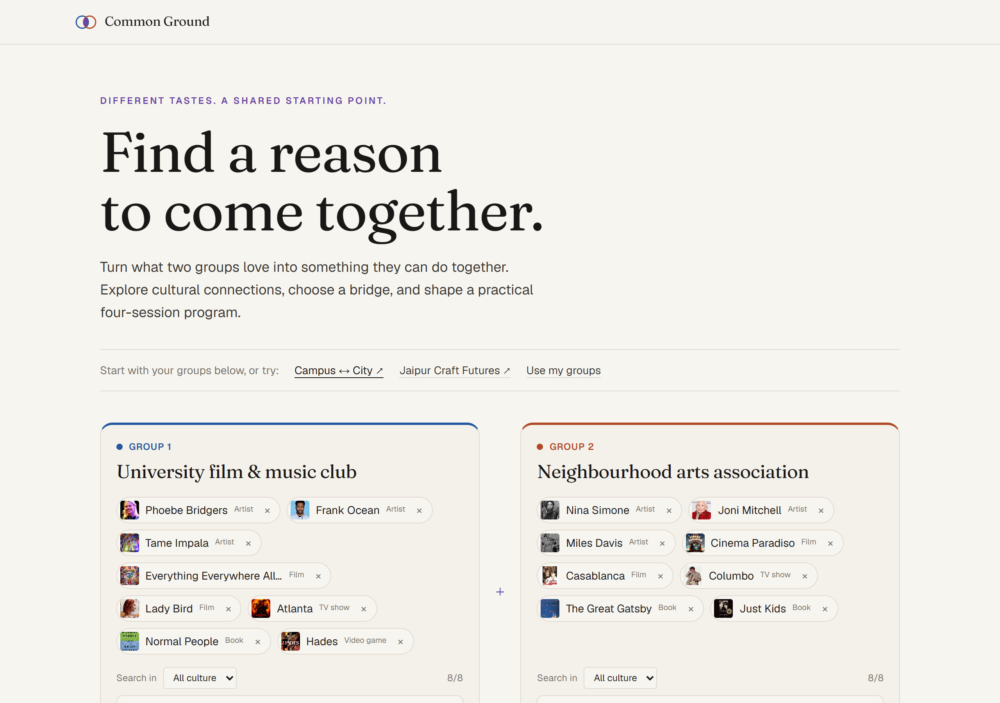
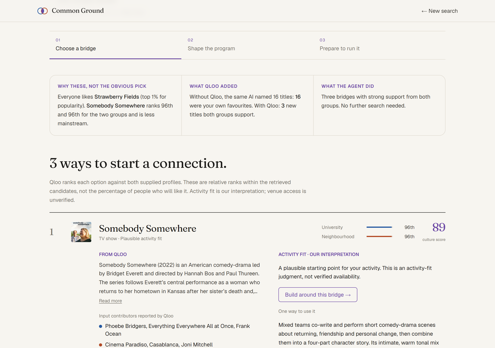
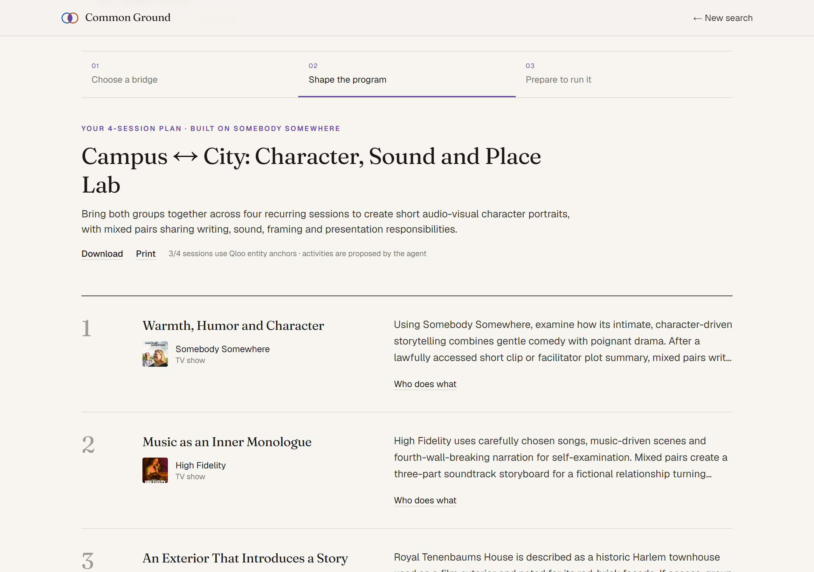
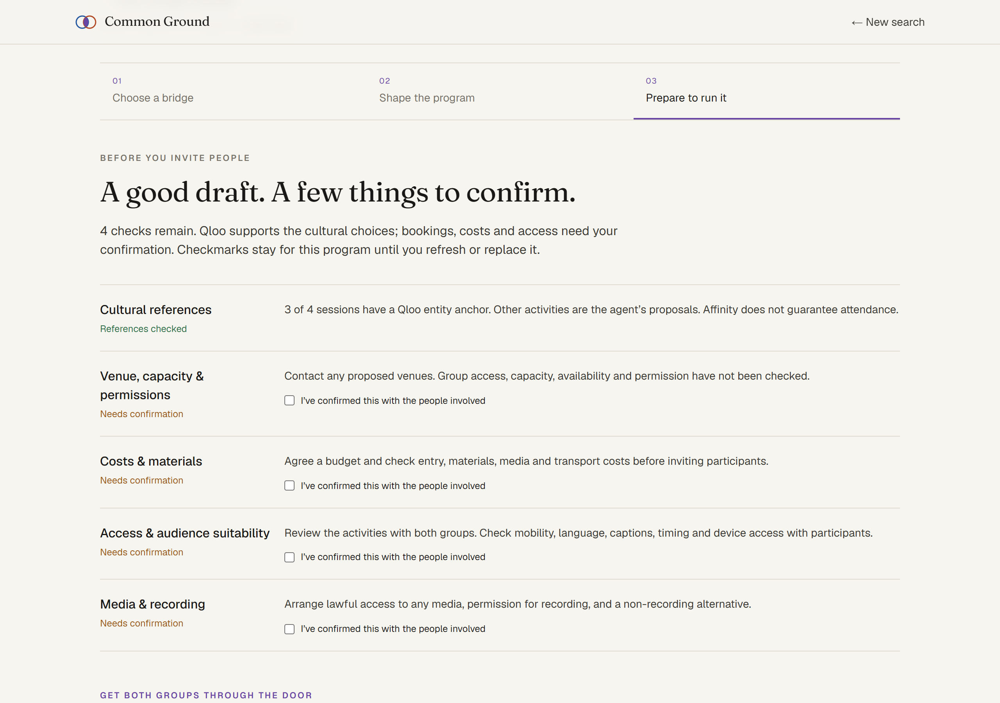

# COMMON GROUND

> Bringing two different groups together? Common Ground uses [Qloo](https://www.qloo.com/)'s taste graph to find culture **both** groups genuinely like, not just what everyone likes, and helps an organizer turn it into a recurring program they can actually run.

Built for the **Qloo Agentic Hackathon 2026**.

**Try it:** **[qloo-hackathon-inky.vercel.app](https://qloo-hackathon-inky.vercel.app)**. Pick *Campus ↔ City* or *Jaipur Craft Futures* for an instant replay, or enter your own groups (a new investigation takes about 60–120 s).



## The problem

University clubs, libraries, museums, community centres and NGOs often want two groups to meet: students and neighbours, teenagers and a choir, newcomers and long-time residents. The usual result is a generic "film night" that one group shows up to. Asking a chatbot doesn't fix it. Given the same favourites, the model alone mostly repeats them back or names titles with no evidence that either group would care (see [Evaluation](docs/EVALUATION.md)).

The hard part is finding something **specific to these two groups**, and then checking it will work in real life.

## What the organizer does

1. **Describe both groups** with 3–8 favourites each (artists, films, TV, books, games, podcasts, places). Qloo resolves every name, and ambiguous matches like *Shōgun* (TV, book or band?) must be confirmed. Or send each group a phone link and import what they name.
2. **Add practical choices:** activity type, participant cost, audience age, group size, an existing venue, access needs, and how adventurous the picks should be (familiar, balanced or exploratory). Free-text notes work too: *"some members are 15–17, keep it free, ideally live music"*.
3. **Choose a bridge.** The page opens on three points: why these beat the obvious mainstream pick, what the same AI produced without Qloo, and what the agent decided. Below them are up to three options, each ranked **separately against both groups** by Qloo, with Qloo's description and which of each group's favourites contributed.
4. **Shape the program.** A 4-session plan built on the chosen bridge, with distinct roles for each group. Rebuild it on another bridge in one click.
5. **Prepare to run it.** A delivery checklist (venue, costs, access, media rights), draft invitations pitched to each group's own tastes, and a side-by-side with what the same model proposes without Qloo.

| Choose a bridge | Shape the program | Prepare to run it |
|---|---|---|
|  |  |  |

## Why it only works with Qloo

| Step | Qloo endpoint | What it decides |
|---|---|---|
| Resolve favourites | `/search` | Every favourite becomes a real entity (typed, with description and image), so nothing downstream is guessed. |
| Discover candidates | `/v2/insights` with both groups' entities as the signal (+ explainability) | ~250 candidates across TV, music, books, podcasts, local places, films and games, plus which favourites contributed. A second, popularity-capped query reaches past the mainstream. |
| Score each group separately | `/v2/insights` with `filter.results.entities`, once per group | A percentile for each group. A bridge must be ≥ 50th for **both**; most candidates (≈ 68%) are one-sided and are rejected. |
| Shared themes and overlap | `/v2/analysis/compare` | Themes both groups share. If there are none, the groups barely overlap and a stricter bar applies. |
| Agent tools | `/v2/tags` + `filter.tags` | When notes ask for e.g. a jazz venue, the agent finds the Qloo place tag and searches the city for it. |

The model never chooses a bridge. Bridges come from deterministic scoring of Qloo data (reproducible: the same input gives the same bridges). The AI agent reads the organizer's notes, reviews the evidence, **decides whether to search further** (another kind of culture, or places on a theme), then writes the plan, critiques it and drafts the invitations. A guard removes any title that isn't in Qloo's evidence, and every decision is shown under *What the agent decided*.

Common Ground is also an **MCP tool** (`find_common_ground`), so Claude, ChatGPT or any MCP client can call it: see [docs/MCP.md](docs/MCP.md).

## Evaluation (formative, automated)

From [docs/EVALUATION.md](docs/EVALUATION.md), run 8: 16 live cases, including mismatched groups, sparse profiles, all-ages settings, an existing free venue, Korean and Japanese titles, and a small city.

- **16 / 16** completed with a plan, and **16 / 16** gave the same bridges when rerun.
- **27 / 27** deterministic checks passed: notes followed, under-18 groups get no mature content, existing venues aren't swapped for outings, weak overlap is flagged rather than filled, every plan anchor is a strong bridge, and non-Latin titles resolve.
- Every shown bridge is at or above the 50th percentile for **both** groups. Bridges average the 74th popularity percentile, against the 98th for the obvious mainstream pick.
- With the same favourites, notes and settings, the model alone named 188 titles: **148 just repeated the groups' favourites** and **40 had no evidence**. Common Ground anchored 58 sessions on new, Qloo-backed titles.

What this does **not** show: that people prefer these programs. Human review by real organizers is pending, and the report lists failure cases and the fixes they led to.

## Run locally

Requires Node.js 22+, a Qloo hackathon key, and the project's ChatGPT-subscription sign-in (no OpenAI API key). Redis is optional locally and required for durable serverless storage.

```bash
git clone https://github.com/Dhamani-aryan/qloo-hackathon.git
cd qloo-hackathon
npm ci
cp .env.example .env.local   # set QLOO_API_KEY; hackathon keys use https://hackathon.api.qloo.com
npm run llm:login            # one-time ChatGPT device sign-in, stored in .secrets/ (git-ignored)
npm run dev -- -p 3005
```

Open [localhost:3005](http://localhost:3005). If a deployment already shares an Upstash credential, set `CHATGPT_AUTH_STORE=redis` with that database instead of signing in again. See [docs/DEPLOY.md](docs/DEPLOY.md).

Checks: `npm test` (186 tests on synthetic Qloo data), `npm run typecheck`, `npm run lint`, `npm run build`. Live checks: `npm run smoke -- <url>` and `npm run spike eval/run.ts`. Real API responses and evaluation outputs stay in git-ignored folders.

## Limits

- Percentiles are **relative ranks** within the retrieved candidates, not the chance that people will enjoy or attend.
- Activity fit is a product heuristic. Venue access, prices, permissions and capacity are **not** verified; the checklist makes that explicit, and "free to participants" is a requirement, not a booking.
- Plans and invitations are drafts for organizers and both communities to review. Nothing here measures social cohesion.
- The model-only comparison shows provenance, not proof of quality.

## More

[How it works](docs/HOW_IT_WORKS.md) · [How to test it](docs/TESTING.md) · [Evaluation](docs/EVALUATION.md) · [Decisions](docs/DECISIONS.md) · [Product plan](common_ground_research_and_plan.md) · [Implementation log](IMPLEMENTATION.md)

## License

[MIT](LICENSE)
